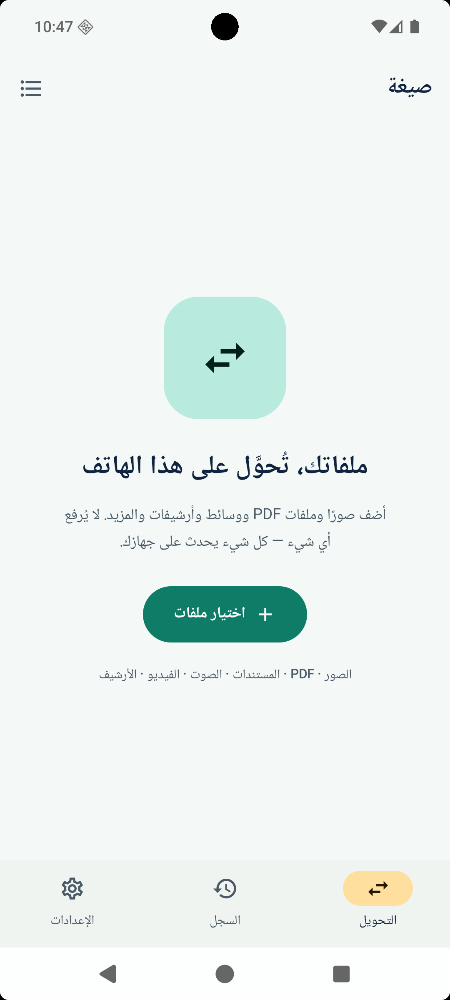
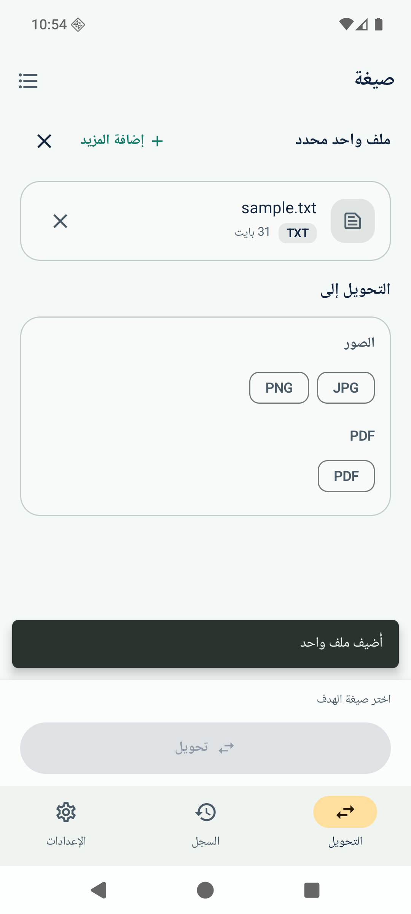
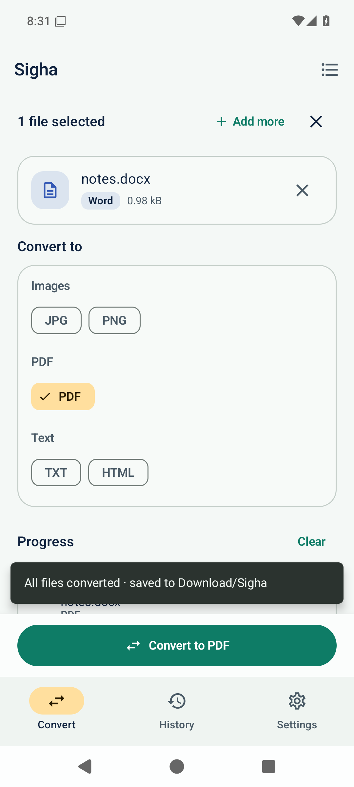
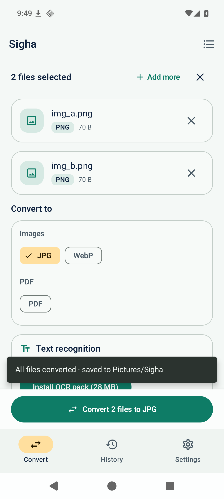
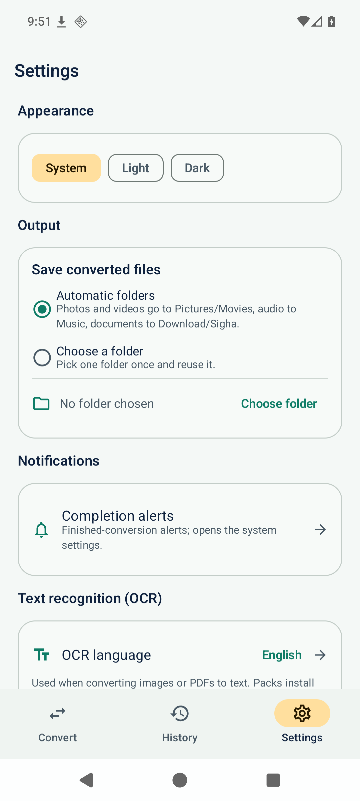
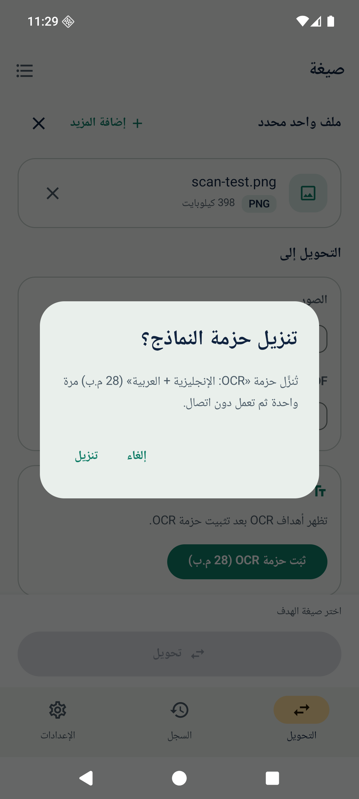

[English](README.md) | **العربية** · *الموقع: [ahmadmhmdsy.github.io/sigha](https://ahmadmhmdsy.github.io/sigha/)*

[](https://github.com/ahmadmhmdsy/sigha/releases)
[](LICENSE)
[](#المتطلبات)
[](#البناء-من-المصدر)
[](#البنية)
[](https://ahmadmhmdsy.github.io/sigha/)
[](CONTRIBUTING.md)

# صيغة: محوّل ملفات يعمل دون اتصال على أندرويد

**صيغة محوّل ملفات يعمل على هاتفك ويحوّل ملفاتك دون رفعها إلى أي خادم — بلا حساب، وبلا إعلانات، وبلا تتبّع.**

صيغة (Sigha) محوّل ملفات لأندرويد قائم على الخصوصية أولًا: يحوّل المستندات والصور وملفات PDF والصوت والفيديو والأرشيفات وملفات البيانات إلى صيغ أخرى داخل الجهاز نفسه، فتستطيع تحويل الملفات دون رفعها إلى أي مكان. صُمّم لمن يعمل من هاتفه في أسواق تعتمد على الهاتف قبل الحاسوب، ومن هنا جاءت واجهته العربية الكاملة مع تخطيط من اليمين إلى اليسار (RTL)، فلا إعلانات ولا حساب ولا تحليلات. التطبيق مكتوب بـ Kotlin وJetpack Compose Material 3، وشيفرته منشورة تحت رخصة Apache-2.0.

**الفهرس**

- [لماذا صيغة](#لماذا-صيغة)
- [التحميل والبدء السريع](#التحميل-والبدء-السريع)
- [لقطات الشاشة](#لقطات-الشاشة)
- [الصيغ المدعومة](#الصيغ-المدعومة)
- [كيف يعمل التوجيه بين الصيغ](#كيف-يعمل-التوجيه-بين-الصيغ)
- [الخصوصية](#الخصوصية)
- [البنية](#البنية)
- [البناء من المصدر](#البناء-من-المصدر)
- [الاختبارات والتحقق](#الاختبارات-والتحقق)
- [القيود المعروفة وخطة الطريق](#القيود-المعروفة-وخطة-الطريق)
- [الأسئلة الشائعة](#الأسئلة-الشائعة)
- [المساهمة](#المساهمة)
- [الرخصة](#الرخصة)
- [الوثائق](#الوثائق)
- [شكر وتقدير](#شكر-وتقدير)

## لماذا صيغة

| ما الذي تحصل عليه | لماذا يهمّك |
|---|---|
| التحويل يتم على الجهاز | يمكنك تحويل الملفات دون رفعها، وتعمل التحويلات دون اتصال بالشبكة |
| بلا حساب وبلا إعلانات وبلا تحليلات | لا يوجد ما تسجّل فيه، ولا ما تحجبه، ولا حزمة تتبّع في البناء |
| 48 صيغة معروفة و39 قابلة للتحويل | مستندات وصور وPDF وصوت وفيديو وأرشيفات وبيانات وترجمات وكتب إلكترونية في تطبيق واحد |
| واجهة عربية كاملة مع RTL | القوائم والنوافذ وصيغ الجمع العربية وسياسة الخصوصية تُقرأ من اليمين إلى اليسار |
| قائمة دفع وسجل محلي | ضع ملفات التحديد كلها في قائمة واحدة، ويُحفظ آخر 50 تحويلًا على الهاتف فقط |
| مجلدات إخراج واضحة | الصور إلى `Pictures/Sigha`، والفيديو إلى `Movies/Sigha`، والصوت إلى `Music/Sigha`، والمستندات إلى `Download/Sigha` — أو مجلد تختاره |
| حزمة OCR اختيارية | تصبح ملفات PDF الممسوحة ضوئيًا والصور نصًا إنجليزيًا أو عربيًا، فقط إذا نزّلت الحزمة |
| مصدر مفتوح ويعمل محليًا | رخصة Apache-2.0 لكود المشروع نفسه، وكل مكتبة ورخصتها مذكورة في [NOTICE.md](NOTICE.md) |

## التحميل والبدء السريع

أحدث بناء هو **v0.2.1** على [صفحة إصدارات GitHub](https://github.com/ahmadmhmdsy/sigha/releases). نزّل ملف APK المناسب لهاتفك، أو استخدم أمر `adb` واحدًا.

| ملف APK | الحجم | SHA-256 | متى تستخدمه |
|---|---|---|---|
| [Sigha-0.2.1-universal-debug.apk](https://github.com/ahmadmhmdsy/sigha/releases/download/v0.2.1/Sigha-0.2.1-universal-debug.apk) | 115,181,014 بايت (نحو 110 ميغابايت) | `FAED0769EE8D2B7F80083808EF860E6BE5A0F60F150FE43205AD891F2A691B4F` | لست متأكدًا من الملف المناسب — يحمل المعماريتين (ABI) ويُثبَّت على أي هاتف مدعوم |
| [Sigha-0.2.1-arm64-debug.apk](https://github.com/ahmadmhmdsy/sigha/releases/download/v0.2.1/Sigha-0.2.1-arm64-debug.apk) | 68,858,338 بايت (نحو 66 ميغابايت) | `00A7A41A98903730DE6D412234B82FAD1DFE0DAB44698E2A5326923EA060B8C5` | إذا كان هاتفك عاديًا بمعمارية arm64 وتريد تنزيلًا أصغر |

```bash
adb install -r Sigha-0.2.1-universal-debug.apk
```

على الهاتف: انسخ ملف APK وافتحه، ثم اسمح لتطبيق الملفات بتثبيت التطبيقات غير المعروفة واضغط «تثبيت». قد ينبّه «Play Protect» بأن المطوّر غير معروف، وهذا متوقع لبناء موقّع بمفتاح التصحيح؛ اختر «تثبيت على أي حال». الخيار `-r` يستبدل التثبيت الحالي ويحتفظ ببياناته.

> **هذه إصدارات تجريبية وليست إصدارات متجر Play.** ملفات APK للإصدار 0.2.1 موقّعة بمفتاح التصحيح (debug) وهي مخصّصة للتثبيت اليدوي والاختبار. لا يمكن رفعها إلى Google Play، ولا يمكنها استبدال تثبيت موقّع من المتجر، ولا تزال 21 علامة قانونية مؤقتة تمنع إصدار Play (متابعة في [docs/legal/release-blockers.md](docs/legal/release-blockers.md)). **التطبيق ليس على متجر Play.**

البصمات أعلاه هي نفس البصمات المسجّلة في `dist/SHA256SUMS.txt` وفي أدلّة التحقق: [docs/qa/evidence/verify-20261122-215316.json](docs/qa/evidence/verify-20261122-215316.json). وملاحظات التثبيت الكاملة للمختبرين في [dist/INSTALL-TEST.md](dist/INSTALL-TEST.md).

### المتطلبات

- أندرويد 8.0 (API 26) أو أحدث؛ جرى البناء والاختبار على أندرويد 16 (API 36).
- جهاز بمعمارية arm64-v8a أو x86_64 (نسخة المحاكي x86_64).
- لا حاجة إلى حساب Google ولا إلى اتصال بالشبكة للتحويل.
- إدخال HEIC يحتاج أندرويد 9 (API 28) فأحدث، وإدخال AVIF يحتاج أندرويد 12 (API 31) فأحدث. على أندرويد 8.0–8.1 يميّز منتقي الملفات صيغة HEIC لكنه لا يستطيع فكّ ترميزها.
- حزمة OCR الاختيارية تنزيل بنحو 28 ميغابايت (الإنجليزية والعربية)، وهو الطلب الوحيد الذي يتصل بالشبكة.

## لقطات الشاشة

ست لقطات من بناء 0.2.1 التجريبي الحالي على محاكٍ بدقة 1080×2400، وبلغة نظام عربية في الشاشات التي تظهر بالعربية. وهي لقطات حقيقية من التطبيق لا صور تصميمية — افتح أي لقطة لعرضها بالحجم الكامل.

<table>
  <tr>
    <td align="center" valign="top">
      <br>
      <sub><b>البداية — بالعربية (RTL)</b></sub>
    </td>
    <td align="center" valign="top">
      <br>
      <sub><b>التحويل — بالعربية</b></sub>
    </td>
    <td align="center" valign="top">
      <br>
      <sub><b>التحويل — بالإنجليزية</b></sub>
    </td>
  </tr>
  <tr>
    <td align="center" valign="top">
      <br>
      <sub><b>نتيجة دفعة — Pictures/Sigha</b></sub>
    </td>
    <td align="center" valign="top">
      <br>
      <sub><b>الإعدادات — السمة والمجلدات</b></sub>
    </td>
    <td align="center" valign="top">
      <br>
      <sub><b>حزمة OCR — 28 م.ب مرة واحدة</b></sub>
    </td>
  </tr>
</table>

## الصيغ المدعومة

يوصف الكتالوج عمدًا بثلاثة أرقام، لأنها ثلاثة أشياء مختلفة:

- **48 صيغة معروفة** — التطبيق يعرف امتداد الملف ونوع MIME ويستطيع تسميته.
- **39 صيغة قابلة للتحويل منها** — يوجد محوّل واحد على الأقل يقبل الصيغة مدخلًا.
- **25 صيغة قابلة للإنتاج** — يوجد محوّل واحد على الأقل يكتب الصيغة مخرَجًا.

الرسم البياني خلف هذه الأرقام يضم **32 محوّلًا** و**172 حافة موجّهة** و**11 عائلة محرّكات**. والتحويل الفعلي هو ما تصفه الجداول أدناه؛ وللحدود الدقيقة لكل صيغة راجع [docs/product/PRODUCT.md](docs/product/PRODUCT.md).

| العائلة | يحوّل من | إلى | المحرّك |
|---|---|---|---|
| الصور | JPG، PNG، WebP، BMP، GIF، HEIC (أندرويد 9+)، AVIF (أندرويد 12+) | JPG، PNG، WebP؛ وأي صورة مدعومة إلى PDF (صفحة A4 واحدة لكل صورة) | ترميزات أندرويد الأساسية (Bitmap وPdfDocument) |
| PDF | PDF (بحدّ 500 ميغابايت) | PNG وJPG مع تحديد نطاق الصفحات؛ TXT مع الرجوع إلى OCR عند المسح الضوئي | PDFBox-Android (النص) وPdfRenderer (الصور) |
| المكتب | DOCX، ODT، XLSX، ODS، PPTX | DOCX إلى TXT وHTML وPDF؛ ODT إلى TXT؛ XLSX إلى CSV وTSV وPDF؛ ODS إلى CSV؛ PPTX إلى TXT | قارئات OOXML/ODF مدمجة (نص وجداول، الورقة الأولى فقط) |
| النصوص | TXT، Markdown، HTML | TXT إلى PDF؛ Markdown إلى PDF؛ HTML إلى TXT | قارئات ومولّد PDF مدمجان |
| البيانات | CSV، TSV، JSON، XLSX، ODS | CSV، TSV، XLSX، JSON | معالجة CSV/TSV مدمجة وJSON عبر kotlinx.serialization |
| الترجمة المرئية | SRT، VTT | SRT، VTT | محلّل مدمج |
| الكتب الإلكترونية | EPUB (غير المشفّر) | TXT، HTML | قارئ EPUB مدمج |
| الأرشيفات | ZIP، TAR.GZ، 7Z | ZIP، TAR.GZ | Apache Commons Compress |
| الوسائط (صوت وفيديو) | MP3، M4A، AAC، WAV، FLAC، OGG، OPUS، AMR (إدخال فقط)؛ MP4، MKV، MOV، AVI، WebM، FLV | أي صيغة صوت مدعومة؛ MP4، WebM، MKV، GIF؛ واستخراج الصوت من الفيديو | FFmpegKit (LGPL-3.0) |
| OCR (حزمة اختيارية) | JPG، PNG، WebP، BMP، GIF، HEIC؛ صفحات PDF الممسوحة | TXT (نموذجا الإنجليزية والعربية) | Tesseract4Android |

تُضبط الخيارات لكل تحويل: جودة الصورة من 20 إلى 100 (الافتراضي 85)، ومعدل البت للصوت والفيديو (تلقائي افتراضيًا)، ونطاق صفحات PDF مثل `1-3,5,8-`، ولغة OCR.

### صيغ معروفة لا يمكن تحويلها

تسع صيغ معروفة **ليس لها أي محوّل** اليوم. يتعرّف عليها صيغة ليشرح أن التحويل غير ممكن، ولا يدّعي دعمها:

| الصيغة | الحالة |
|---|---|
| TIFF | معروفة فقط — لا يوجد مفكّك ترميز مضمّن |
| RTF | معروفة فقط |
| TAR | معروفة فقط (`TAR.GZ` مدعومة) |
| BZ2 | معروفة فقط |
| XZ | معروفة فقط |
| YAML | معروفة فقط |
| XML | معروفة فقط |
| MOBI | معروفة فقط |
| FB2 | معروفة فقط |

إذا اختير ملف من إحدى هذه الصيغ، يبلّغ التطبيق بعدم توفّر تحويل بدلًا من عرض هدف لا يعمل. وعبارة «كل الصيغ تعمل» ليست ادعاءً يقدّمه هذا المشروع.

## كيف يعمل التوجيه بين الصيغ

صيغة ليس قائمة وصفات ثابتة، بل رسم بياني للتحويل: كل محوّل يعلن الصيغ التي يقبلها والتي يُخرجها، والموجّه هو الذي يجد السلسلة.

1. لا يعرض المنتقي إلا الأهداف التي يمكن الوصول إليها من **كل** ملف محدد (المشترك بينها)، فتُضمن دفعة يمكن تحويلها كاملة.
2. يشغّل المخطّط بحثًا موحّد الكلفة ويعيد سلسلة **أقل عدد من القفزات**، بحدّ 3 قفزات — مثلًا يمكن اكتشاف مسار مثل DOCX ← PDF ← JPG دون كود خاص.
3. التعادل حتمي: ترتيب المحوّلات ثم معرّف الصيغة، فيحلّ الزوج نفسه بالطريقة نفسها دائمًا.
4. المحوّل الذي يُنشئ عدة ملفات (PDF ← صورة لكل صفحة) لا يُسمح به إلا في **القفزة الأخيرة**، فلا يُسقط مسار صفحات بصمت.
5. تحويل ملف إلى صيغته نفسها مرفوض برسالة لا بعملية بلا أثر، والزوج غير القابل للوصول يعطي خطأ مسمّى «لا يوجد تحويل متاح».
6. إضافة محوّل تعني إضافة حافة واحدة إلى عائلة محرّكات واحدة؛ ويلتقط الموجّه والواجهة الحافة تلقائيًا دون عبارة `when` ضخمة.

## الخصوصية

صيغة تطبيق يعمل محليًا: محرّك التحويل لا خادم يتحدّث إليه.

- **لا رفع.** تُقرأ الملفات عبر منتقي النظام (Storage Access Framework) أو عبر مشاركة واردة، وتُحوَّل في ذاكرة تخزين مؤقت خاصة بالتطبيق، ثم تُكتب في مجموعة عامة أو مجلد تمنحه أنت، وتُحذف الذاكرة المؤقتة بعد ذلك.
- **بلا حساب وبلا إعلانات وبلا تحليلات، وبلا حزمة الإبلاغ عن الأعطال، وبلا حزمة تتبّع.** لا تسجيل دخول ولا اشتراك ولا اعتماد على الفوترة.
- **الطلب الوحيد الذي يتصل بالشبكة** هو تنزيل حزمة OCR الاختيارية. تبدأه أنت، ويُظهر حجمها ورخصتها قبل البدء، وينبّه على الاتصالات المقنّنة بالبيانات، وهي مثبّتة ببصمة SHA-256، وتُستأنف عبر HTTP Range، ولا تُرسل **أي ملف أو اسم ملف أو معرّف**. وإلى أن تثبّت الحزمة لا تُعرض أهداف OCR إطلاقًا.
- **الإخراج والأذونات.** تُحفظ الملفات في `Pictures/Sigha` و`Movies/Sigha` و`Music/Sigha` و`Download/Sigha` (أو مجلد تختاره). يطلب التطبيق منتقي النظام بدلًا من صلاحية وصول واسعة، ولا يطلب صلاحية التخزين إطلاقًا على أندرويد 10 فأحدث.
- **البيانات الوصفية لا تنتقل.** تحويلات الصوت والفيديو تُزيل البيانات الوصفية والفصول؛ والصور تُفكّك ثم تُعاد ترميزها، فلا تُنسخ بيانات EXIF — ومنها موقع GPS — إلى الناتج.
- **النسخ الاحتياطي معطّل** (`android:allowBackup="false"`)، فسجل التحويلات والإعدادات لا تدخل نسخ أندرويد السحابي.

النص الكامل في [docs/legal/privacy-policy.md](docs/legal/privacy-policy.md)، والسياسة نفسها مضمّنة في التطبيق (بالإنجليزية والعربية).

## البنية

الكود منظّم تحت `app/src/main/java/com/sigha/converter`:

```text
ui/          شاشات Compose وViewModels (التحويل، القائمة، السجل، الإعدادات، الحزم، التراخيص، الخصوصية)
data/        مشغّل التحويل، ونشر الناتج (MediaStore / SAF)، والإعدادات، والسجل، وتنزيل الحزم
work/        خدمة التحويل في المقدمة والقائمة
core/        FileFormat وFormatRegistry وConverter وConverterRegistry وRoutePlanner وOutputDestination
engine/      حزمة لكل عائلة: image وpdf وoffice وtext وdata وsubtitle وebook وmedia وocr وarchive وupscale
model/       حزم النماذج القابلة للتنزيل (كتالوج، وتثبيت يستأنف ويتحقق من SHA-256)
```

يمرّ التحويل بهذا المسار:

```text
file picker / share intent
        │
        ▼
FormatRegistry.detect()  ──►  FileFormat (48 recognised)
        │
        ▼
ConverterRegistry ──► RoutePlanner (uniform cost, ≤ 3 hops) ──► [converter, converter, ...]
        │
        ▼
ConversionService (foreground)  ──►  per-hop cache files  ──►  OutputDestination
        │                                                          │
        ▼                                                          ▼
History (last 50)                                    Pictures / Movies / Music / Download "Sigha"
                                                     or a user-granted SAF folder
```

تُربط حزم `engine` من نقطة واحدة هي `BuiltInConverters.kt`: كل عائلة تعيد قائمتها من المحوّلات، فإذا فشلت عائلة تُسجّل المشكلة وتُتجاوز بدلًا من إسقاط التطبيق كله. وعائلة `upscale` الفارغة مسجّلة حفاظًا على صدق الكتالوج — لا تُشحن أي حزمة رفع دقة.

## البناء من المصدر

المتطلبات: **JDK 21**، ومنصّة Android SDK **36** وأدوات البناء **36.0.0**، وغلاف Gradle (8.11.1). بيئة التطوير الأساسية ويندوز، ويعمل الغلاف أيضًا على لينكس وماك.

```powershell
# اختبارات الوحدة وملف APK للتصحيح (نسخة شاملة وتقسيمات لكل معمارية). الناتج: app\build\outputs\apk\debug\
.\gradlew.bat :app:testDebugUnitTest :app:assembleDebug --no-daemon --console=plain
```

```bash
# المكافئ على لينكس وماك
./gradlew :app:testDebugUnitTest :app:assembleDebug --no-daemon --console=plain
```

بناء الإصدار (مع تقسيم ABI) يحتاج إعداد توقيع في `keystore/keystore.properties` وهو مستبعد من Git؛ وبدونه يكون بناء الإصدار غير موقّع عمدًا. أما حزمة التطبيق (AAB) فتُبنى مع تعطيل التقسيم:

```powershell
.\gradlew.bat :app:assembleRelease --no-daemon --console=plain
.\gradlew.bat :app:bundleRelease --no-daemon --console=plain
```

وبوابة التحقق كاملة — بناء نظيف واختبارات JVM ووقائع APK ومحاذاة المكتبات الأصلية وzipalign وملفات إصدار APK وتواقيعها وAAB وlint وتطابق موارد الإنجليزية والعربية وفحص العلامات القانونية وانحراف الادعاءات — تُشغَّل بالأمر:

```powershell
pwsh -File scripts/verify.ps1
```

وتكتب أدلة آلية في `docs/qa/evidence/verify-<timestamp>.json`. وإذا كنت تعمل على محاكٍ، فالسكربت `scripts/feature-smoke.ps1` يشغّل الواجهة الحقيقية من البداية إلى النهاية (وهو مُدمّر، لمحاكي اختبار مخصّص فقط) ويكتب `docs/qa/evidence/features-<timestamp>/`.

## الاختبارات والتحقق

هذه هي ادعاءات الاختبار الوحيدة في هذا الملف، ولكل منها دليل آلي في المستودع:

| الفحص | النتيجة | الدليل |
|---|---|---|
| اختبارات JVM | **155 اختبارًا في 19 صنفًا، 0 فشل، 0 خطأ** | [verify-20261122-215316.json](docs/qa/evidence/verify-20261122-215316.json) |
| Android lint | **0 أخطاء** (66 تحذيرًا) | ملف الدليل نفسه |
| فحص الميزات على المحاكي | **37 من 37 خطوة ناجحة**، 0 انهيار | [features-20261122-214849/](docs/qa/evidence/features-20261122-214849/) |
| التغليف | 32 مكتبة أصلية مخزّنة دون ضغط، ومحاذاة 16 كيلوبايت لـ arm64، ونجاح zipalign | ملف الدليل نفسه |
| تطابق موارد الإنجليزية والعربية وانحراف الادعاءات | نظيف | ملف الدليل نفسه |

شمل تشغيل المحاكي: اختيار الملفات، واختيار الهدف، ونافذة تمهيد الإشعارات، ودفعة صورتين إلى JPG حُفظت في `Pictures/Sigha`، والأهداف المحفوظة، وفشل ملف تالف وإعادة محاولته، وملف مصدر محذوف ظهر بالرمز `FILE_ACCESS_LOST`، وتحويل TXT ← PDF، وWAV ← MP3 محفوظًا في `Music/Sigha`، وسطر الإشعارات في الإعدادات، ودفعة في الخلفية أرسلت إشعار اكتمالها، ولا `FATAL EXCEPTION` في سجل logcat.

**ما لم يُتحقّق منه:** الاختبار على أجهزة حقيقية (لم يحدث)، وتشغيل arm64، وتغطية الترميزات في العالم الواقعي، والأداء المقاس. المحاكي x86_64 بنظام API 36. سجل الحالة الصادق في [docs/qa/verification.md](docs/qa/verification.md)، وقائمة التحقق على الأجهزة الحقيقية التي تسدّ هذه الفجوة في [docs/qa/device-checklist.md](docs/qa/device-checklist.md).

## القيود المعروفة وخطة الطريق

الحدود الحالية، بصراحة:

- **تسع صيغ معروفة ولا يمكن تحويلها** — TIFF وRTF وTAR وBZ2 وXZ وYAML وXML وMOBI وFB2.
- **دعم حزمة المكتب نصوص وجداول، لا محاكاة تنسيق كاملة.** استخراج DOCX/XLSX يُسقط الصور ومربعات النص والتنسيق الدقيق؛ وXLSX يحوّل الورقة الأولى فقط.
- **تحرير PDF خارج النطاق.** يحوّل صيغة ملفات PDF وإليها، لكن لا دمج ولا تقسيم ولا حذف صفحات ولا ضغط ولا تعليقات ولا إزالة كلمات مرور.
- **ملفات PDF الممسوحة تحتاج حزمة OCR**، وهي للإنجليزية والعربية فقط؛ ودقة OCR تتوقف على جودة الصورة ولا نضمنها.
- **لا رفع دقة (upscaling).** عائلة الرفع مسجّلة لكنها فارغة، ولا تُشحن أي حزمة أو بيئة ONNX.
- **لا دعم RAR ولا إنشاء 7Z**؛ فـ7Z يُحوَّل إلى ZIP فقط، والأرشيفات تُعاد تعبئتها لا تُتصفّح.
- **لا ضغط إلى حجم هدف محدد.** يمكنك إعادة الترميز بجودة أو معدل بت محددين، لا «اجعل الملف 5 ميغابايت».
- **HEIC يحتاج أندرويد 9 (API 28) فأحدث** وهو غير مدعوم على أندرويد 8.0–8.1؛ وAVIF يحتاج أندرويد 12 فأحدث.
- **لا تحويل متوازٍ**: قائمة الدفع تعمل تسلسليًا، ملفًا واحدًا في كل مرة.
- **التوزيع تجريبي فقط حاليًا**: ملفات APK موقّعة بمفتاح التصحيح، و21 علامة قانونية مؤقتة تمنع إصدار Play.

خطة الطريق، بالترتيب ودون تواريخ (من [PRODUCT.md](PRODUCT.md)):

1. **التالي:** تحويل عدة صور إلى ملف PDF واحد، وضغط صورة أو فيديو إلى حجم قابل للمشاركة.
2. **ثم:** دمج PDF وتقسيمه وضغطه.
3. **لاحقًا:** التصوير بالكاميرا ثم تجميع الصفحات في ملف PDF واحد مع حزمة OCR العربية. ورفع الدقة فقط إذا تحقّقت حزمة على جهاز حقيقي.

## الأسئلة الشائعة

### هل يمكن تحويل HEIC إلى JPG دون اتصال على أندرويد؟

نعم، على أندرويد 9 (API 28) فأحدث: تُفكّ صيغة HEIC على الجهاز وتُعاد ترميزها JPG دون اتصال بالشبكة. على أندرويد 8.0–8.1 (API 26–27) لا تستطيع المنصّة فكّ HEIC، فيوضّح صيغة ذلك بدلًا من الفشل الصامت. وHEIC صيغة إدخال فقط — لا يكتب صيغة ملفات HEIC.

### هل يرفع صيغة ملفاتي؟

لا. التحويلات تجري على الهاتف. والطلب الوحيد الذي يتصل بالشبكة في التطبيق هو تنزيل حزمة OCR الاختيارية الذي تبدأه بنفسك، ولا يُرسل أي ملف أو اسم ملف أو معرّف. أما التحويل نفسه فلا يلمس الشبكة إطلاقًا.

### هل صيغة مجانية؟ هل فيها إعلانات أو حساب؟

التطبيق مجاني، بلا إعلانات وبلا حساب وبلا اشتراك وبلا مشتريات داخل التطبيق. ولا توجد حزمة تحليلات أو تتبّع. المشروع مفتوح المصدر برخصة Apache-2.0.

### هل يعمل صيغة بالعربية؟

نعم. الواجهة مترجمة بالكامل إلى العربية وبتخطيط من اليمين إلى اليسار، مع صيغ الجمع العربية؛ وسياسة الخصوصية تُشحن بالعربية أيضًا، ولـOCR نموذج لغة عربية. ويتبع التطبيق لغة النظام.

### هل يمكن تحويل PDF إلى نص، بما في ذلك PDF الممسوح ضوئيًا (OCR)؟

نعم، تحويل PDF ← TXT يستخدم PDFBox لاستخراج طبقة النص مع نطاق صفحات. وإذا كانت الصفحات المحددة مسحًا ضوئيًا بلا طبقة نص، يعود صيغة إلى OCR بعد أن تثبّت الحزمة الاختيارية (~28 ميغابايت، الإنجليزية والعربية). وبدون الحزمة يشرح كيفية تثبيتها بدلًا من إنتاج ملف فارغ.

### هل يمكن تحويل صفحات PDF إلى JPG أو PNG، أو الصور إلى PDF؟

نعم: PDF ← PNG/JPG مع نطاق صفحات مثل `1-3,5,8-`، وأي صورة مدعومة ← PDF (صورة واحدة لكل صفحة A4). ولا يوجد بعدُ تحويل عدة صور إلى PDF واحد ولا دمج أو تقسيم أو ضغط لملفات PDF.

### هل يمكن تحويل DOCX أو XLSX إلى PDF؟

نعم، كتابةً نصية وجداول: DOCX ← PDF/TXT/HTML، وXLSX ← PDF/CSV/TSV. ولا يُحفظ التنسيق الأصلي ولا الصور ولا الشكل الدقيق، وXLSX يحوّل الورقة الأولى فقط. وقد تظهر التواريخ كأرقام تسلسلية من الجدول.

### هل يمكن تحويل الفيديو إلى MP3 أو التحويل بين صيغ الصوت؟

نعم. يُحوَّل الصوت بين MP3 وM4A وAAC وWAV وFLAC وOGG وOPUS (وAMR إدخال فقط)، ويمكن استخراج الصوت من كل حاويات الفيديو المدعومة. والفيديو يُحوَّل إلى MP4 أو WebM أو MKV أو GIF. ويمرّ كل ذلك عبر FFmpegKit بمهلة 20 دقيقة لكل ملف، مع إزالة البيانات الوصفية والفصول.

### هل يعمل صيغة دون اتصال، وما إصدارات أندرويد المدعومة؟

تعمل التحويلات دون اتصال بالشبكة — وضع الطيران كافٍ. ويدعم التطبيق أندرويد 8.0 فأحدث؛ والإجراء الوحيد الذي يحتاج الشبكة هو تنزيل حزمة OCR الاختياري. وإدخال HEIC يحتاج أندرويد 9 فأحدث، وإدخال AVIF يحتاج أندرويد 12 فأحدث.

### هل صيغة على متجر Play؟

لا. ملفات v0.2.1 على صفحة إصدارات GitHub هي إصدارات تجريبية تُثبَّت يدويًا وموقّعة بمفتاح التصحيح، ولا تزال 21 علامة قانونية مؤقتة (رابط الخصوصية، وعرض مصدر LGPL، وصندوق بريد) تمنع إصدار Play. وحين يتغيّر ذلك ستقول ملاحظات الإصدار وهذا الملف ذلك صراحة.

## المساهمة

نرحّب بالمساهمات: تقارير الأخطاء، وطلبات الصيغ مع ملفات نموذجية، والترجمات، وتصحيحات الوثائق، والكود. اقرأ [CONTRIBUTING.md](CONTRIBUTING.md) أولًا، ثم افتح مشكلة عبر القوالب في [.github/ISSUE_TEMPLATE/](.github/ISSUE_TEMPLATE/) أو أرسل طلب دمج.

يشغّل سير عمل GitHub Actions الموجود في [.github/workflows/ci.yml](.github/workflows/ci.yml) اختبارات JVM وبناء التصحيح عند كل دفع أو طلب دمج. وهذه قواعد المشروع التي تُبقي الملف والتطبيق صادقين:

- **يجب أن تكون الادعاءات قابلة للتحقق.** `scripts/verify.ps1` هو البوابة، ويفشل عند الأرقام القديمة أو انحراف العربية عن الإنجليزية أو بقايا العلامات المؤقتة.
- **لا تُضف صيغة لا يستطيع المحرّك تحويلها.** تسع صيغ في الكتالوج معروفة فقط عن قصد.
- **حافظ على دقة بيان الخصوصية.** تنزيل حزمة OCR هو الطلب الوحيد الذي يتصل بالشبكة؛ لا تصف التطبيق بأنه يعمل دون اتصال مطلقًا.
- **لا حزم جديدة تجمع البيانات**، ولا إعلانات ولا تحليلات.

هذا إصدار عام مبكّر؛ ويرجى الإبلاغ عن مشكلات الأمان بشكل خاص كما هو موضّح في [SECURITY.md](SECURITY.md).

## الرخصة

كود المشروع نفسه مرخّص تحت **رخصة أباتشي 2.0** — راجع [LICENSE](LICENSE). وتحتفظ المكوّنات الخارجية برخصها: Apache-2.0 وMIT وBSD و0BSD وIJG وSIL OFL للمكتبات، و**LGPL-3.0** لـFFmpegKit وFFmpeg. ويسرد [NOTICE.md](NOTICE.md) كل مكوّن مشحون ورخصته؛ وتُشحن نصوص الرخص كاملة داخل التطبيق تحت الإعدادات ← التراخيص.

FFmpegKit مرخّص LGPL-3.0: لا يزال نشر المصدر المقابل وصندوق بريد حقيقي لعرض المصدر عائق توزيع مفتوحًا (B6 في [docs/legal/release-blockers.md](docs/legal/release-blockers.md))، لذا فعرض المصدر غير مكتمل حتى يُغلق ذلك.

استُلهم صيغة من *فكرة* [Filee](https://github.com/KnifeLemon/Filee) (MIT، سطح المكتب). وصيغة كود Kotlin أصلي: لا يُستخدم أي كود أو علامة أو شعار أو لقطة شاشة أو هوية بصرية من Filee.

## الوثائق

| الوثيقة | ما تغطيه |
|---|---|
| [PRODUCT.md](PRODUCT.md) | تعريف المنتج في صفحة واحدة: المشكلة والمستخدمون والميزة التنافسية والنطاق وأهداف ما هو خارج النطاق وخطة الطريق |
| [docs/product/PRODUCT.md](docs/product/PRODUCT.md) | مواصفات القدرات: مصفوفة كل صيغة والخيارات وقواعد التوجيه والحدود |
| [docs/product/store-listing.md](docs/product/store-listing.md) | نصوص المتجر وقائمة لقطات الشاشة وأجوبة بيانات الأمان |
| [docs/product/aso-plan-2026-11-19.md](docs/product/aso-plan-2026-11-19.md) | بحث الكلمات المفتاحية وخطة الظهور في المتاجر |
| [docs/qa/verification.md](docs/qa/verification.md) | أدلة البناء والاختبار والتشغيل المقاسة — وما لم يُقس |
| [docs/qa/device-checklist.md](docs/qa/device-checklist.md) | قائمة التحقق على الأجهزة الحقيقية التي تسدّ فجوة التشغيل |
| [docs/release-notes-v0.2.1.md](docs/release-notes-v0.2.1.md) | ملاحظات إصدار v0.2.1 التجريبي |
| [docs/publishing-checklist.md](docs/publishing-checklist.md) | خطوات النشر اليدوية التي يقوم بها الإنسان وحده |
| [docs/legal/privacy-policy.md](docs/legal/privacy-policy.md) | سياسة الخصوصية (بالإنجليزية، والنص العربي يُشحن في التطبيق) |
| [docs/legal/release-blockers.md](docs/legal/release-blockers.md) | الأعمال البشرية التي تمنع إصدارًا عامًا على Play |
| [docs/legal/clearance-memo.md](docs/legal/clearance-memo.md) | مذكّرة التخليص الشرعي والقانوني وراء المشروع |
| [docs/adr/](docs/adr/) | سجلات قرارات البنية (محرّك الوسائط ونموذج التنفيذ والميزة التنافسية) |
| [CHANGELOG.md](CHANGELOG.md) | التغييرات الظاهرة للمستخدم في كل إصدار |
| [NOTICE.md](NOTICE.md) | إشعارات المكوّنات الخارجية وعرض المصدر لـLGPL |
| [dist/INSTALL-TEST.md](dist/INSTALL-TEST.md) | ملاحظات التثبيت والاختبار لملفات APK التجريبية |
| [docs/README.md](docs/README.md) | فهرس بقية الوثائق |
| [README.md](README.md) | هذا الملف بالإنجليزية |

## شكر وتقدير

- استُلهمت فكرة محوّل الملفات القائم على رسم بياني من [Filee](https://github.com/KnifeLemon/Filee) (MIT). ولا يتضمّن المشروع أي كود أو أصول من Filee.
- المحرّكات: [PDFBox-Android](https://github.com/TomRoush/PdfBox-Android) لاستخراج نص PDF (Apache-2.0)، و[FFmpegKit](https://github.com/arthenica/ffmpeg-kit) (LGPL-3.0)، و[Apache Commons Compress](https://commons.apache.org/proper/commons-compress/) (Apache-2.0)، و[XZ for Java](https://tukaani.org/xz/java.html) (0BSD)، و[Tesseract4Android](https://github.com/adaptech-cz/Tesseract4Android) (Apache-2.0). أما قارئات OOXML/ODF والنصوص ومولّد PDF والبيانات والترجمات وEPUB فهي كود أصلي للمشروع.
- نماذج OCR: [tessdata_best](https://github.com/tesseract-ocr/tessdata_best) للإنجليزية والعربية (Apache-2.0)، تُنزَّل كحزمة مثبّتة.
- الواجهة: Kotlin وJetpack Compose وMaterial 3 (Apache-2.0).
- لقطات الشاشة من تشغيلات أدلّة الاختبار الخاصة بالمشروع؛ والشاشات العربية استُخدمت فيها لغة نظام عربية.
