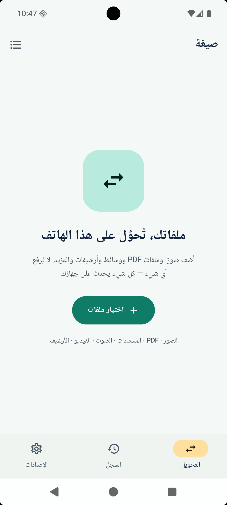
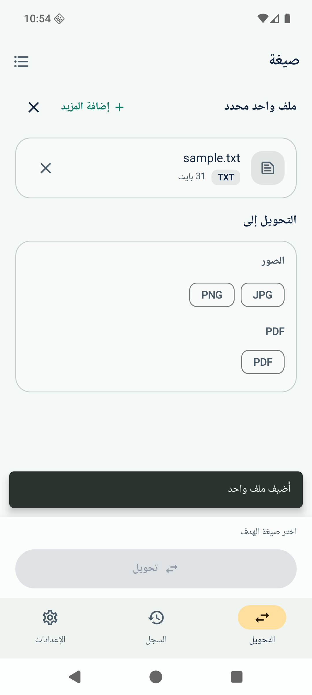
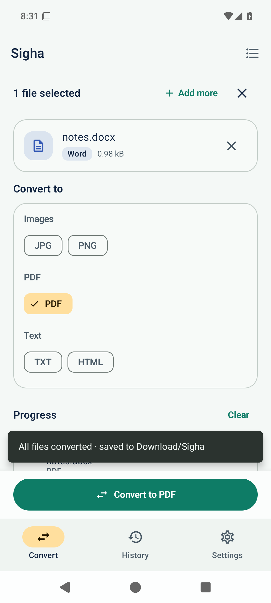
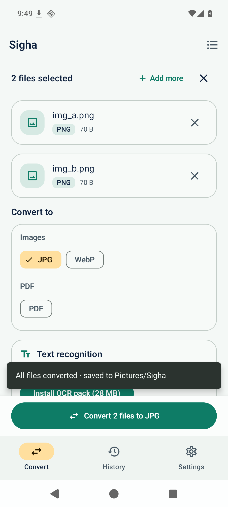
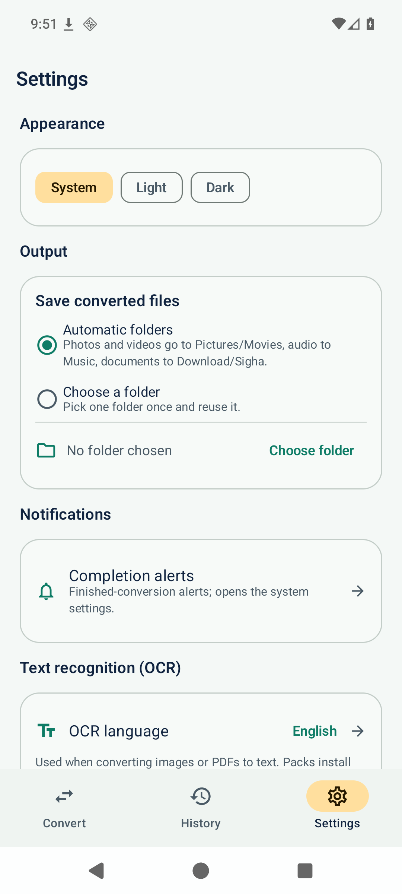

**English** | [العربية](README.ar.md) · *Website: [ahmadmhmdsy.github.io/sigha](https://ahmadmhmdsy.github.io/sigha/)*

[](https://github.com/ahmadmhmdsy/sigha/releases)
[](LICENSE)
[](#requirements)
[](#build-from-source)
[](#architecture)
[](https://ahmadmhmdsy.github.io/sigha/)
[](CONTRIBUTING.md)

# Sigha (صيغة): offline file converter for Android

**Sigha is an offline file converter for Android that converts files on your phone — no upload, no account, no ads.**

Sigha (صيغة) is a privacy-first file converter for Android that turns documents, images, PDFs, audio, video, archives and data files into other formats on the device itself: you can convert files without uploading them anywhere. It is built for people who treat the phone as their office — including Arabic-speaking users in phone-first markets — so the whole interface is translated into Arabic with a full right-to-left (RTL) layout, and there are no ads, no account and no analytics. Written in Kotlin with Jetpack Compose Material 3, released under Apache-2.0.

**Contents**

- [Why Sigha](#why-sigha)
- [Download and quick start](#download-and-quick-start)
- [Screenshots](#screenshots)
- [Supported formats](#supported-formats)
- [How conversion routing works](#how-conversion-routing-works)
- [Privacy](#privacy)
- [Architecture](#architecture)
- [Build from source](#build-from-source)
- [Tests and verification](#tests-and-verification)
- [Known limitations and roadmap](#known-limitations-and-roadmap)
- [FAQ](#faq)
- [Contributing](#contributing)
- [License](#license)
- [Documentation](#documentation)
- [Credits](#credits)

## Why Sigha

| What you get | Why it matters |
|---|---|
| Conversion runs on the device | You can convert files without uploading them, and conversions work without a network connection |
| No account, no ads, no analytics | There is nothing to sign up for, nothing to block, and no tracking SDK in the build |
| 48 recognised formats, 39 convertible | Documents, images, PDF, audio, video, archives, data, subtitles and e-books in one app |
| Full Arabic interface with RTL | Menus, dialogs, counted plurals and the privacy policy read right-to-left |
| Batch queue and local history | Queue every file from one selection; the last 50 conversions are kept on the phone only |
| Predictable output folders | Images go to `Pictures/Sigha`, video to `Movies/Sigha`, audio to `Music/Sigha`, documents to `Download/Sigha` — or a folder you choose |
| Optional OCR pack | Scanned PDFs and photos become English or Arabic text, only if you download the pack |
| Open-source and local-first | Apache-2.0 for the project's own code; every library and licence is listed in [NOTICE.md](NOTICE.md) |

## Download and quick start

The latest build is **v0.2.1** on the [GitHub Releases page](https://github.com/ahmadmhmdsy/sigha/releases). Download the APK that matches your phone, or run one `adb` command.

| APK | Size | SHA-256 | Use it when |
|---|---|---|---|
| [Sigha-0.2.1-universal-debug.apk](https://github.com/ahmadmhmdsy/sigha/releases/download/v0.2.1/Sigha-0.2.1-universal-debug.apk) | 115,181,014 B (~110 MB) | `FAED0769EE8D2B7F80083808EF860E6BE5A0F60F150FE43205AD891F2A691B4F` | You are not sure which file to pick — it carries both ABIs and installs on any supported phone |
| [Sigha-0.2.1-arm64-debug.apk](https://github.com/ahmadmhmdsy/sigha/releases/download/v0.2.1/Sigha-0.2.1-arm64-debug.apk) | 68,858,338 B (~66 MB) | `00A7A41A98903730DE6D412234B82FAD1DFE0DAB44698E2A5326923EA060B8C5` | You have an ordinary arm64 phone and want the smaller download |

```bash
adb install -r Sigha-0.2.1-universal-debug.apk
```

On the phone: copy the APK over, open it, allow "Install unknown apps" for that one app and tap Install. Play Protect may warn about an unknown developer; that is expected for a debug-key build — choose "Install anyway". `-r` replaces an existing install and keeps its data.

> **These are QA builds, not Play Store builds.** The v0.2.1 APKs are signed with the Android **debug key** and are meant for side-loading and testing. They are not uploadable to Google Play, they cannot replace a Play-signed install, and 21 legal placeholders still block a Play release (tracked in [docs/legal/release-blockers.md](docs/legal/release-blockers.md)). The app is **not on the Play Store**.

The checksums above are the same ones recorded in `dist/SHA256SUMS.txt` and in the verification evidence: [docs/qa/evidence/verify-20261122-215316.json](docs/qa/evidence/verify-20261122-215316.json). Full install notes for testers are in [dist/INSTALL-TEST.md](dist/INSTALL-TEST.md).

### Requirements

- Android 8.0 (API 26) or newer; compiled and tested against Android 16 (API 36).
- An arm64-v8a or x86_64 device (the emulator build is x86_64).
- No Google account, no network connection for conversion.
- HEIC input needs Android 9 (API 28)+; AVIF input needs Android 12 (API 31)+. On Android 8.0–8.1 the picker can identify HEIC files but they cannot be decoded.
- The optional OCR pack is a ~28 MB download (English + Arabic) and the only network request the app makes.

## Screenshots

Captured from the current 0.2.1 QA build on a 1080×2400 emulator with an Arabic system locale where the UI is Arabic. They are real screenshots from the app, not mock-ups.



*The Arabic home screen: right-to-left layout, Arabic tagline and the single "Choose files" action.*



*The convert screen in Arabic: one file selected, only reachable targets are offered.*



*English convert screen: a DOCX converted to PDF and saved to `Download/Sigha`.*



*A finished image batch: the result message names the real output folder, `Pictures/Sigha`.*



*Settings: theme, output folders, completion alerts and the OCR language.*

## Supported formats

The catalogue is deliberately described in three numbers, because they are three different things:

- **48 formats recognised** — the app knows the extension/MIME type and can name the file.
- **39 formats convertible from** — at least one converter accepts the format as input.
- **25 formats producible** — at least one converter can write the format as output.

The graph behind those numbers holds **32 converters**, **172 directed edges** and **11 engine families**. Conversion is what the tables below describe; for the exact per-format limits, see [docs/product/PRODUCT.md](docs/product/PRODUCT.md).

| Family | Converts from | To | Engine |
|---|---|---|---|
| Images | JPG, PNG, WebP, BMP, GIF, HEIC (Android 9+), AVIF (Android 12+) | JPG, PNG, WebP; any supported image to PDF (one A4 page each) | Android platform codecs (Bitmap, PdfDocument) |
| PDF | PDF (500 MB cap) | PNG and JPG with a page range; TXT with an OCR fallback for scans | PDFBox-Android (text) + Android PdfRenderer (pages) |
| Office | DOCX, ODT, XLSX, ODS, PPTX | DOCX to TXT, HTML, PDF; ODT to TXT; XLSX to CSV, TSV, PDF; ODS to CSV; PPTX to TXT | Built-in OOXML/ODF readers (text and tables, first worksheet) |
| Text | TXT, Markdown, HTML | TXT to PDF; Markdown to PDF; HTML to TXT | Built-in readers and PDF writer |
| Data | CSV, TSV, JSON, XLSX, ODS | CSV, TSV, XLSX, JSON | Built-in CSV/TSV handling (kotlinx.serialization for JSON) |
| Subtitles | SRT, VTT | SRT, VTT | Built-in parser |
| E-books | EPUB (unencrypted) | TXT, HTML | Built-in EPUB reader |
| Archives | ZIP, TAR.GZ, 7Z | ZIP, TAR.GZ | Apache Commons Compress |
| Media (audio/video) | MP3, M4A, AAC, WAV, FLAC, OGG, OPUS, AMR (input only); MP4, MKV, MOV, AVI, WebM, FLV | Any supported audio format; MP4, WebM, MKV, GIF; audio extracted from video | FFmpegKit (LGPL-3.0) |
| OCR (optional pack) | JPG, PNG, WebP, BMP, GIF, HEIC; scanned PDF pages | TXT (English and Arabic models) | Tesseract4Android |

Options are per conversion: image quality 20–100 (default 85), audio/video bitrate (auto by default), a PDF page range such as `1-3,5,8-`, and an OCR language.

### Recognised but not convertible

Nine recognised formats have **no converter at all** today. Sigha identifies them so it can explain that nothing can be done — it does not pretend they are supported:

| Format | Status |
|---|---|
| TIFF | Recognised only — no decoder is bundled |
| RTF | Recognised only |
| TAR | Recognised only (`TAR.GZ` is handled) |
| BZ2 | Recognised only |
| XZ | Recognised only |
| YAML | Recognised only |
| XML | Recognised only |
| MOBI | Recognised only |
| FB2 | Recognised only |

If a file in one of these formats is selected, the app reports that no conversion is available instead of offering a dead target. "Every format works" is not a claim this project makes.

## How conversion routing works

Sigha is a conversion graph, not a list of hard-coded recipes. Every converter declares the formats it accepts and the formats it emits; the router finds the chain.

1. The picker only offers targets reachable from **every** selected file (the intersection), so a batch can always be converted.
2. The planner runs a uniform-cost search and returns the **fewest-hop** chain, at most 3 hops — for example a route such as DOCX → PDF → JPG can be discovered without special-case code.
3. Ties are deterministic: converter order, then format id, so the same pair always resolves the same way.
4. A converter that produces several files (PDF → one image per page) is only allowed as the **final** hop, so a route can never silently drop pages.
5. Converting a file to its own format is rejected with a message instead of a no-op, and an unreachable pair produces a named "no conversion available" error.
6. Adding a converter means adding one edge to one engine family; the router and UI pick it up without a giant `when` statement.

## Privacy

Sigha is a local-first app: the conversion engine has no server to talk to.

- **No upload.** Files are read through the system file picker (Storage Access Framework) or an incoming share, converted in app-private cache, written to a public collection or a folder you grant, and the cache is deleted afterwards.
- **No account, no ads, no analytics, no crash-reporting SDK, no tracking SDK.** There is no login, no subscription and no billing dependency.
- **The only network request** is the optional OCR language pack download. It is started by you, shows its size and licence first, warns on metered connections, is pinned by SHA-256, resumes over HTTP Range, and sends **no file, filename or identifier**. Until you install the pack, OCR targets are simply not offered.
- **Output and permissions.** Files are saved to `Pictures/Sigha`, `Movies/Sigha`, `Music/Sigha` or `Download/Sigha` (or a folder you pick). The app requests the system picker instead of broad storage access, and does not request storage permission at all on Android 10+.
- **Metadata does not travel.** Audio/video conversions strip metadata and chapters; images are decoded and re-encoded, so EXIF — including GPS location — is not copied into the result.
- **Backup is disabled** (`android:allowBackup="false"`), so conversion history and settings stay out of Android cloud backup.

The full text is in [docs/legal/privacy-policy.md](docs/legal/privacy-policy.md), and the same policy ships inside the app (English and Arabic).

## Architecture

The code is organised under `app/src/main/java/com/sigha/converter`:

```text
ui/          Compose screens and ViewModels (convert, queue, history, settings, packs, licences, privacy)
data/        conversion runner, output publishing (MediaStore / SAF), settings, history, pack downloads
work/        foreground conversion service + queue
core/        FileFormat, FormatRegistry, Converter, ConverterRegistry, RoutePlanner, OutputDestination
engine/      one package per family: image, pdf, office, text, data, subtitle, ebook, media, ocr, archive, upscale
model/       downloadable model packs (catalogue, SHA-256-verified resumable install)
```

A conversion flows as:

```text
file picker / share intent
        │
        ▼
FormatRegistry.detect()  ──►  FileFormat (48 recognised)
        │
        ▼
ConverterRegistry ──► RoutePlanner (uniform cost, ≤ 3 hops) ──► [converter, converter, ...]
        │
        ▼
ConversionService (foreground)  ──►  per-hop cache files  ──►  OutputDestination
        │                                                          │
        ▼                                                          ▼
History (last 50)                                    Pictures / Movies / Music / Download "Sigha"
                                                     or a user-granted SAF folder
```

The `engine` packages are wired through one point, `BuiltInConverters.kt`: each family returns its own converter list, so a failure in one family is logged and skipped instead of taking down the whole app. The empty `upscale` family is registered to keep the catalogue honest — no upscaling model ships.

## Build from source

Requirements: **JDK 21**, Android SDK platform **36** and build-tools **36.0.0**, and the Gradle wrapper (8.11.1). Windows is the primary development environment; the wrapper also works on Linux and macOS.

```powershell
# Unit tests + debug APK (universal + per-ABI split). APK output: app\build\outputs\apk\debug\
.\gradlew.bat :app:testDebugUnitTest :app:assembleDebug --no-daemon --console=plain
```

```bash
# Linux / macOS equivalents
./gradlew :app:testDebugUnitTest :app:assembleDebug --no-daemon --console=plain
```

Release builds (ABI splits) need a signing config in `keystore/keystore.properties`, which is git-ignored; without it the release build is intentionally unsigned. The App Bundle runs with splits disabled:

```powershell
.\gradlew.bat :app:assembleRelease --no-daemon --console=plain
.\gradlew.bat :app:bundleRelease --no-daemon --console=plain
```

The whole verification gate — clean build, JVM tests, debug APK facts, stored/ELF alignment, zipalign, release APKs and signatures, AAB, lint, EN/AR resource parity, legal-placeholder scan and stale-claim drift — runs with:

```powershell
pwsh -File scripts/verify.ps1
```

It writes machine-readable evidence to `docs/qa/evidence/verify-<timestamp>.json`. If you are working on an emulator, `scripts/feature-smoke.ps1` drives the real UI end to end (destructive, dedicated QA emulator only) and writes `docs/qa/evidence/features-<timestamp>/`.

## Tests and verification

These are the only test claims this README makes, and each one has machine-readable evidence in the repository:

| Check | Result | Evidence |
|---|---|---|
| JVM unit tests | **155 tests in 19 classes, 0 failures, 0 errors** | [verify-20261122-215316.json](docs/qa/evidence/verify-20261122-215316.json) |
| Android lint | **0 errors** (66 warnings) | same evidence file |
| Emulator feature smoke | **37 of 37 steps pass**, 0 crashes | [features-20261122-214849/](docs/qa/evidence/features-20261122-214849/) |
| Packaging | 32 native libraries stored uncompressed, arm64 16 KB page alignment, zipalign pass | same evidence file |
| EN/AR resource parity and claim drift | clean | same evidence file |

The emulator run covered: selecting files, target selection, the notification-priming dialog, a two-image JPG batch saved to `Pictures/Sigha`, remembered targets, a corrupt file failing and retrying, a deleted source reported as `FILE_ACCESS_LOST`, TXT → PDF, WAV → MP3 saved to `Music/Sigha`, the Settings notification row, a backgrounded batch posting its completion notification, and no `FATAL EXCEPTION` in logcat.

What is **not** verified: physical-device QA (there has been none), arm64 runtime testing, real-world codec coverage, and measured performance. The emulator is x86_64 API 36. The honest status log is [docs/qa/verification.md](docs/qa/verification.md), and the physical-device checklist that would close the gap is [docs/qa/device-checklist.md](docs/qa/device-checklist.md).

## Known limitations and roadmap

Current limits, stated plainly:

- **Nine formats are recognised but cannot be converted** — TIFF, RTF, TAR, BZ2, XZ, YAML, XML, MOBI, FB2.
- **Office support is text and tables, not layout fidelity.** DOCX/XLSX extraction drops images, text boxes and exact formatting; XLSX converts the first worksheet only.
- **PDF editing is out of scope.** Sigha converts PDFs and to PDFs, but there is no merge, split, page deletion, compression, annotation or password removal.
- **Scanned PDFs need the OCR pack**, which is English + Arabic only; OCR accuracy depends on image quality and is not promised.
- **No upscaling.** The upscale family is registered but empty; no model or ONNX runtime ships.
- **No RAR support and no 7Z creation**; 7Z can only be converted to ZIP, and archives can be repacked, not browsed.
- **No target-size compression.** You can re-encode at a quality or bitrate, not at "make this 5 MB".
- **HEIC needs Android 9+ (API 28)** and is unsupported on Android 8.0–8.1; AVIF needs Android 12+.
- **No multitasking conversion**: the batch queue runs sequentially, one file at a time.
- **Distribution is QA-only today**: the APKs are debug-signed, and 21 legal placeholders block a Play release.

Roadmap, in order and without dates (from [PRODUCT.md](PRODUCT.md)):

1. **Next:** many images → one PDF, and compressing a photo or video to a shareable size.
2. **Then:** PDF merge, split and compress.
3. **Later:** camera capture → page assembly → one PDF, with the Arabic OCR pack integrated. Upscaling only if a model is verified on a device.

## FAQ

### Can I convert HEIC to JPG offline on Android?

Yes, on Android 9 (API 28) or newer: HEIC is decoded on the device and re-encoded as JPG, with no network. On Android 8.0–8.1 (API 26–27) the platform cannot decode HEIC, and Sigha tells you so instead of failing silently. HEIC is input-only — Sigha does not write HEIC.

### Does Sigha upload my files?

No. Conversions run on the phone. The only network request in the app is the optional OCR pack download that you start yourself; it sends no file, filename or identifier. Conversion itself never touches the network.

### Is Sigha free? Are there ads or an account?

Sigha is free, with no ads, no account, no subscription and no in-app purchases. There is no analysis or tracking SDK either. The project is open source under Apache-2.0.

### Does Sigha work in Arabic?

Yes. The interface is fully translated into Arabic and laid out right-to-left, with Arabic plural forms; the privacy policy ships in Arabic too, and OCR has an Arabic language model. The app follows the system locale.

### Can Sigha convert a PDF to text, including a scanned PDF (OCR)?

Yes, PDF → TXT uses PDFBox to extract the text layer and a page range. If the selected pages are a scan with no text layer, Sigha falls back to OCR — after you install the optional OCR pack (~28 MB, English and Arabic). Without the pack it explains how to install it instead of producing an empty file.

### Can Sigha convert PDF pages to JPG or PNG, or images to PDF?

Yes: PDF → PNG/JPG with a page range (`1-3,5,8-`), and any supported image → PDF (one image per PDF page, A4). There is no many-images-to-one-PDF and no PDF merge, split or compression yet.

### Can I convert DOCX or XLSX to PDF?

Yes, as text and tables: DOCX → PDF/TXT/HTML, XLSX → PDF/CSV/TSV. Layout, images and exact formatting are not preserved, and XLSX converts the first worksheet only. Dates may appear as spreadsheet serial numbers.

### Can Sigha convert video to MP3 or convert between audio formats?

Yes. Audio can be converted between MP3, M4A, AAC, WAV, FLAC, OGG and OPUS (AMR is input only), and audio can be extracted from every supported video container. Video converts to MP4, WebM, MKV or GIF. Media runs through FFmpegKit with a 20-minute per-file timeout and metadata/chapter stripping.

### Does Sigha work offline, and which Android versions does it support?

Conversions work without a network connection — airplane mode is fine. The app supports Android 8.0+; the single online action is the opt-in OCR pack download. HEIC input needs Android 9+, AVIF input needs Android 12+.

### Is Sigha on the Play Store?

No. The v0.2.1 builds on GitHub Releases are side-load QA builds signed with the Android debug key, and 21 legal placeholders (privacy URL, LGPL source offer, mailbox) still block a Play release. When that changes, the release notes and this README will say so.

## Contributing

Contributions are welcome — bug reports, format requests with sample files, translations, documentation fixes and code. Read [CONTRIBUTING.md](CONTRIBUTING.md) first, then open an issue using the templates in [.github/ISSUE_TEMPLATE/](.github/ISSUE_TEMPLATE/) or send a pull request.

The GitHub Actions workflow in [.github/workflows/ci.yml](.github/workflows/ci.yml) runs the JVM unit tests and the debug build on every push and pull request. A few project rules that keep the README and the app honest:

- **Claims must be verifiable.** `scripts/verify.ps1` is the gate, and it fails on stale numbers, EN/AR drift and leftover placeholders.
- **Do not add a format the engine cannot convert.** Nine catalogue formats are intentionally recognised-only.
- **Keep the privacy statement exact.** The OCR pack download is the only network request; do not describe the app as working with no network connection at all.
- **No new SDKs that collect data**, and no ads or analytics.

This is an early public release; please report security issues privately as described in [SECURITY.md](SECURITY.md).

## License

The project's own code is licensed under the **Apache License 2.0** — see [LICENSE](LICENSE). Third-party components keep their own licences: Apache-2.0, MIT, BSD, 0BSD, IJG and SIL OFL for the libraries, and **LGPL-3.0** for FFmpegKit/FFmpeg. [NOTICE.md](NOTICE.md) lists every shipped component and its licence; the full licence texts ship inside the app under Settings → Licenses.

FFmpegKit is LGPL-3.0: publishing the Corresponding Source and a real source-offer mailbox is still an open distribution blocker (B6 in [docs/legal/release-blockers.md](docs/legal/release-blockers.md)), so the source offer is incomplete until that is closed.

Sigha was inspired by the *idea* of [Filee](https://github.com/KnifeLemon/Filee) (MIT, desktop). Sigha is original Kotlin code: no Filee code, brand, logo, screenshots or assets are used.

## Documentation

| Document | What it covers |
|---|---|
| [PRODUCT.md](PRODUCT.md) | One-page product definition: problem, users, wedge, shipped scope, non-goals, roadmap |
| [docs/product/PRODUCT.md](docs/product/PRODUCT.md) | Capability specification: per-format matrix, options, routing rules, limits |
| [docs/product/store-listing.md](docs/product/store-listing.md) | Store copy, screenshot shot list and Data safety answers |
| [docs/product/aso-plan-2026-11-19.md](docs/product/aso-plan-2026-11-19.md) | Keyword research and the discovery plan |
| [docs/qa/verification.md](docs/qa/verification.md) | Measured build, test and runtime evidence — and what was not measured |
| [docs/release-notes-v0.2.1.md](docs/release-notes-v0.2.1.md) | Release notes for the v0.2.1 QA build |
| [docs/publishing-checklist.md](docs/publishing-checklist.md) | The manual, human-only steps that publish the repository |
| [docs/qa/device-checklist.md](docs/qa/device-checklist.md) | The physical-device QA checklist that closes the runtime gap |
| [docs/legal/privacy-policy.md](docs/legal/privacy-policy.md) | Privacy policy (English; the Arabic text ships in the app) |
| [docs/legal/release-blockers.md](docs/legal/release-blockers.md) | The human-only work that blocks a public Play release |
| [docs/legal/clearance-memo.md](docs/legal/clearance-memo.md) | The legal/ḥalāl clearance memo behind the project |
| [docs/adr/](docs/adr/) | Architecture decision records (media engine, execution model, product wedge) |
| [CHANGELOG.md](CHANGELOG.md) | User-visible changes per release |
| [NOTICE.md](NOTICE.md) | Third-party notices and the LGPL source offer |
| [dist/INSTALL-TEST.md](dist/INSTALL-TEST.md) | Install and test notes for the QA APKs |
| [docs/README.md](docs/README.md) | Index of the rest of the documentation |
| [README.ar.md](README.ar.md) | This README in Arabic |

## Credits

- The idea of a graph-based local file converter was inspired by [Filee](https://github.com/KnifeLemon/Filee) (MIT). No Filee code or assets are included.
- Engines: [PDFBox-Android](https://github.com/TomRoush/PdfBox-Android) for PDF text extraction (Apache-2.0), [FFmpegKit](https://github.com/arthenica/ffmpeg-kit) (LGPL-3.0), [Apache Commons Compress](https://commons.apache.org/proper/commons-compress/) (Apache-2.0), [XZ for Java](https://tukaani.org/xz/java.html) (0BSD) and [Tesseract4Android](https://github.com/adaptech-cz/Tesseract4Android) (Apache-2.0). The OOXML/ODF, text/PDF-writer, data, subtitle and EPUB readers are first-party code.
- OCR models: [tessdata_best](https://github.com/tesseract-ocr/tessdata_best) English and Arabic (Apache-2.0), downloaded as a pinned pack.
- UI: Kotlin, Jetpack Compose and Material 3 (Apache-2.0).
- Screenshots come from the project's own QA evidence runs; the Arabic screens use an Arabic system locale.
